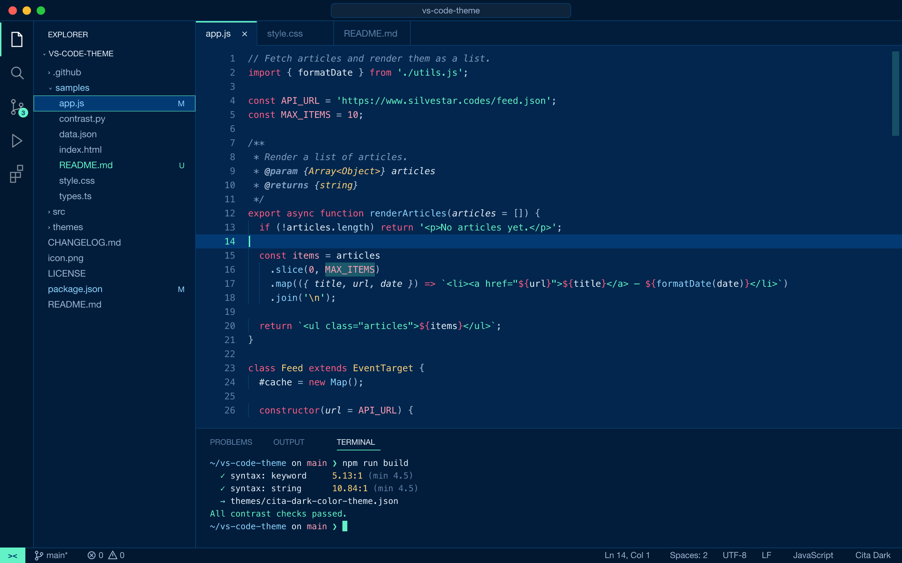
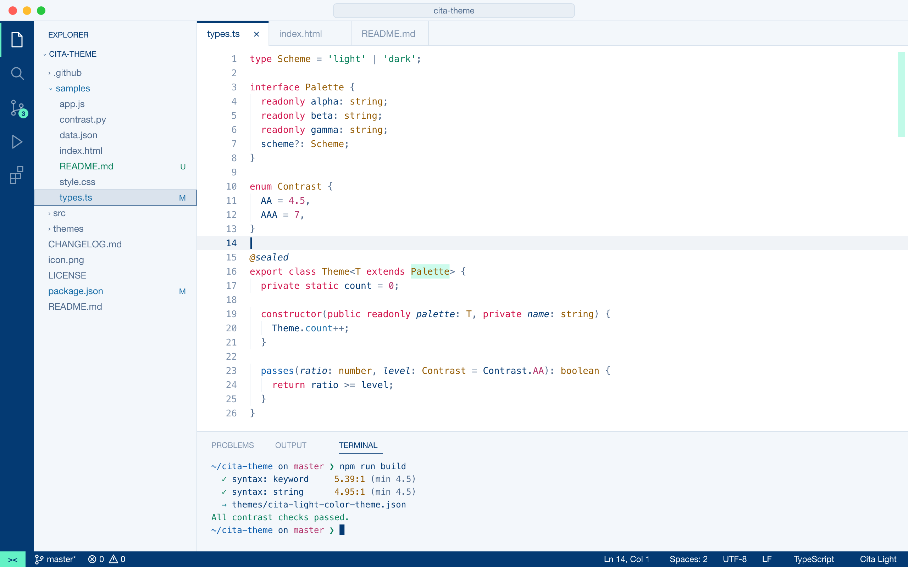

# Cita Theme

[](https://marketplace.visualstudio.com/items?itemName=starbist.cita-theme)
[](https://marketplace.visualstudio.com/items?itemName=starbist.cita-theme)
[](https://open-vsx.org/extension/starbist/cita-theme)
[](https://github.com/maliMirkec/cita-theme/actions/workflows/ci.yml)

Light and dark VS Code themes based on the colors of [silvestar.codes](https://www.silvestar.codes).

| Color | Hex | Role |
|---|---|---|
| Mint | `#63F2C5` | Strings, cursor, accents, and scrollbars |
| Pink | `#FF3366` | Keywords, badges, and find matches |
| Navy | `#043A73` | Dark theme highlights, and light theme text and activity bar |

## Themes

### Cita Dark

A deep navy editor (`#02264D`) with the site's navy (`#043A73`) for the current line and selected items, and mint and pink accents.



### Cita Light

A white editor with navy text, a navy activity bar and status bar, and darker versions of mint and pink that are readable on white.



Every syntax color meets WCAG AA contrast (4.5:1) against its editor background. Comments meet at least 3.5:1.

## Install

- **VS Code:** install [Cita Theme](https://marketplace.visualstudio.com/items?itemName=starbist.cita-theme) from the Marketplace, or run `code --install-extension starbist.cita-theme`.
- **Cursor, Windsurf, VSCodium:** install [Cita Theme](https://open-vsx.org/extension/starbist/cita-theme) from Open VSX.

Then run **Preferences: Color Theme** (<kbd>Cmd</kbd>/<kbd>Ctrl</kbd>+<kbd>K</kbd> <kbd>Cmd</kbd>/<kbd>Ctrl</kbd>+<kbd>T</kbd>) and choose **Cita Dark** or **Cita Light**.

To switch automatically with your OS appearance, add this to your settings:

```json
{
  "window.autoDetectColorScheme": true,
  "workbench.preferredDarkColorTheme": "Cita Dark",
  "workbench.preferredLightColorTheme": "Cita Light"
}
```

## Contributing

Found a color that's hard to read or a language that looks unstyled? [Open an issue](https://github.com/maliMirkec/cita-theme/issues/new/choose). See [CONTRIBUTING.md](CONTRIBUTING.md) for how the theme is built.

## License

[MIT](LICENSE) © Silvestar Bistrović
